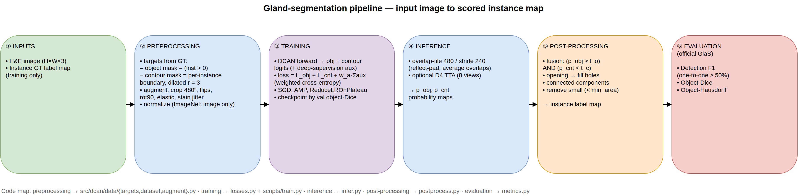

# Code walkthrough — reading guide

This folder explains the whole project end-to-end, **in order**, mapping each stage to the exact
code and to our own diagrams (in `../diagrams/`). Read the files in the numbered sequence:

| # | Document | What it covers | Main code |
|---|----------|----------------|-----------|
| 1 | [`01_overview.md`](01_overview.md) | The problem, the DCAN idea, the two models, big-picture input→output | — |
| 2 | [`02_preprocessing.md`](02_preprocessing.md) | Image + GT → object & contour targets, augmentation | `src/dcan/data/` |
| 3 | [`03_model_architecture.md`](03_model_architecture.md) | Atrous encoder, multi-level fusion, dual branches, upsampling | `src/dcan/models/dcan.py` |
| 4 | [`04_training.md`](04_training.md) | Loss + deep supervision, optimizer, checkpoint selection, the loop | `losses.py`, `scripts/train.py` |
| 5 | [`05_inference_postprocessing.md`](05_inference_postprocessing.md) | Overlap-tile, TTA, fusion + morphology → instances | `infer.py`, `postprocess.py` |
| 6 | [`06_evaluation.md`](06_evaluation.md) | The official GlaS metrics, results, accuracy roadmap | `metrics.py`, `scripts/` |

## How it all fits together

Each document points at the precise functions and now matches the **inline comments** added to the
code, so you can read the prose here and the comments side-by-side. The diagrams are editable in
[draw.io](https://app.diagrams.net) (`../diagrams/*.drawio`) and exported as PNGs alongside them.

## One-paragraph summary

We re-implement **DCAN** (Deep Contour-Aware Network, Chen et al., CVPR 2016) to segment individual
colon glands in H&E histology images (GlaS challenge). A shared atrous VGG-16 encoder feeds **two
decoder branches** — one predicts the gland body, one predicts gland **contours** — and a fusion
rule subtracts the predicted contour to split apart touching glands, which an object-only network
cannot do. We also train an object-only **FCN baseline** to isolate the contour branch's benefit.

Related top-level docs: [`../REPORT.md`](../REPORT.md) (verification & results),
[`../ACCURACY_ANALYSIS.md`](../ACCURACY_ANALYSIS.md) (why we trail the paper + improvement roadmap),
[`../CODE_STRUCTURE.md`](../CODE_STRUCTURE.md) (file-by-file reference).

Next → [`01_overview.md`](01_overview.md)
