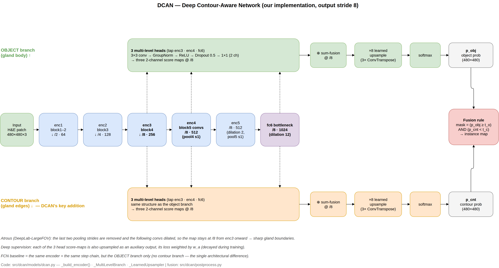

# 1 · Overview — the problem and the big picture

← [`00_README.md`](00_README.md)

## The task

Given an **H&E-stained histology image** of colon tissue, output an **instance segmentation**: a
label map where every individual gland is a separate region with its own id. The hard part is that
glands often **touch** — a method that only predicts "gland vs background" merges neighbours into
one blob, which is wrong both visually and by the scoring metrics.

Dataset: **GlaS @ MICCAI'2015** (Warwick-QU), 85 labelled training images + an official test set.
(For the final evaluation we present the Part-A test set; see `../REPORT.md`.)

## The DCAN idea

DCAN predicts **two things** from a shared encoder:
- an **object** map (gland body), and
- a **contour** map (gland boundary).

At inference the two are fused: keep a pixel only if it is object **and not** contour. Subtracting
the predicted contour carves the seam between touching glands, so connected-component labelling
then yields separate instances. That is the whole point of the "contour-aware" design.

## The two models in this project

| Model | Branches | Role |
|-------|----------|------|
| **DCAN** | object **+ contour** | the contour-aware network |
| **FCN baseline** | object only | ablation — isolates the contour branch's value |

Both share the **same encoder and multi-level fusion**; the FCN baseline simply omits the contour
branch (`src/dcan/models/fcn_baseline.py`). On the test set DCAN beats the baseline on every metric,
and the gap is largest on the boundary metric (Hausdorff) — exactly what the contour branch targets.

## Input → output at a glance

1. **Preprocess** the image and build object/contour targets → [`02_preprocessing.md`](02_preprocessing.md)
2. **Model** turns the image into object & contour probability maps → [`03_model_architecture.md`](03_model_architecture.md)
3. **Train** with a deep-supervised weighted-CE loss → [`04_training.md`](04_training.md)
4. **Infer + post-process** (overlap-tile, TTA, fusion, morphology) → [`05_inference_postprocessing.md`](05_inference_postprocessing.md)
5. **Evaluate** with the official GlaS metrics → [`06_evaluation.md`](06_evaluation.md)

Next → [`02_preprocessing.md`](02_preprocessing.md)
