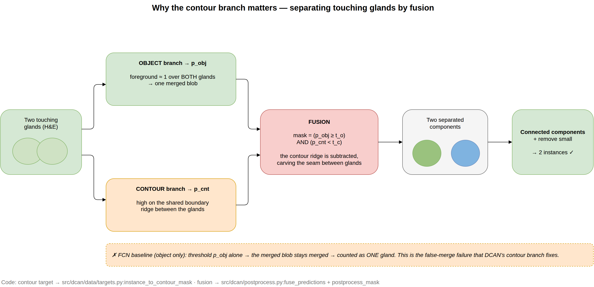

# 5 · Inference & post-processing — probabilities to instances

← [`04_training.md`](04_training.md) · code: `src/dcan/infer.py`, `src/dcan/postprocess.py`

The network outputs per-pixel probabilities; this stage turns them into a clean **instance label
map**. Two sub-steps: (A) get full-image probability maps, (B) fuse + clean into instances.

## 5.1 Overlap-tile inference — `infer.overlap_tile_predict`

Test images are larger than the 480² training crop, so we slide the window with **50% overlap**
(stride 240). The image is reflect-padded to a whole number of strides; each tile's **softmax
probabilities** are accumulated into a running sum with a per-pixel hit-count, then averaged. This
covers every pixel by several tiles and removes the seams a non-overlapping tiling would leave.
(We average probabilities, not logits.) Returns `p_obj` and, for DCAN, `p_cnt`.

## 5.2 Test-time augmentation (optional) — `infer.predict_with_tta`

A free accuracy boost with no retraining: run inference on the **8 D4 views** (4 rotations × flip),
map each prediction back to the original orientation, and average. Both `p_obj` and `p_cnt` are
TTA-averaged consistently. Enable with `--tta` in `scripts/infer.py`. On our test set TTA lifts DCAN
by ~+0.07 F1 / +0.02 Dice and lowers Hausdorff (see [`../ACCURACY_ANALYSIS.md`](../ACCURACY_ANALYSIS.md) §2).

## 5.3 Fusion + morphology — `postprocess.py`

1. **Fusion rule** (`fuse_predictions`): `mask = (p_obj ≥ t_o) AND (p_cnt < t_c)`. Keep a pixel only
   if it is gland body **and not** an edge — subtracting the contour ridge carves apart touching
   glands. (Defaults `t_o = t_c = 0.5`.)
2. **Cleanup** (`postprocess_mask`), in order: morphological **opening** (remove thin bridges/specks)
   → **fill holes** (solid gland interiors) → **connected-component labelling** (one id per blob) →
   **remove small** objects (< `min_area`) → **relabel** ids to 1..N.

The FCN baseline has no `p_cnt`, so `postprocess_fcn` thresholds `p_obj` alone — which is exactly why
it leaves touching glands merged.

> These thresholds (`t_o`, `t_c`, `min_area`) are tunable **without retraining**:
> `scripts/tune_postprocess.py` sweeps them on a held-out fold.

Run it: `uv run python scripts/infer.py --config <cfg> --ckpt <best.pt> --split test_a [--tta]`,
then evaluate (next doc).

Next → [`06_evaluation.md`](06_evaluation.md)
